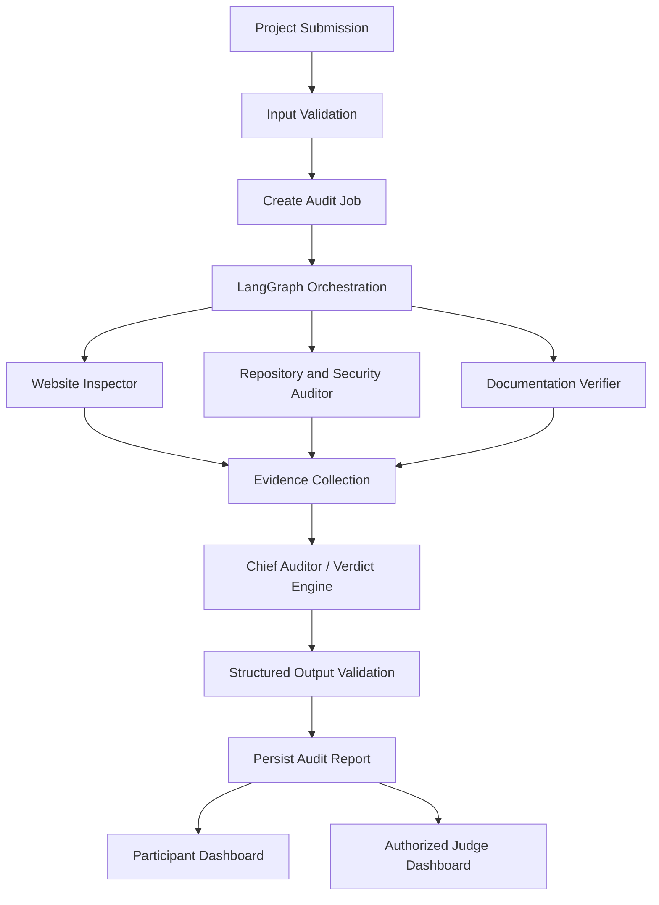

# VeriFyra AI

### One Application. Four Intelligence Layers. One Trusted Verdict.

**VeriFyra AI** is a multi-agent software verification platform designed to identify inconsistencies between what a software project documents, what its source code implements, and what its live website actually does.

Built for the **Best Use of Gemma by Google** hackathon, VeriFyra AI combines specialized AI agents, deterministic analysis tools, browser-based inspection, and evidence correlation to produce structured, traceable software audit reports.

> **Core innovation:** Cross-layer consistency intelligence — connecting documentation, source code, and runtime behavior instead of analyzing each source in isolation.

---

## Table of Contents

- [The Problem](#the-problem)
- [Our Solution](#our-solution)
- [Key Features](#key-features)
- [The Four-Agent Architecture](#the-four-agent-architecture)
- [How It Works](#how-it-works)
- [Technology Stack](#technology-stack)
- [System Architecture](#system-architecture)
- [User Roles and Permissions](#user-roles-and-permissions)
- [Security and Trust](#security-and-trust)
- [Project Structure](#project-structure)
- [Prerequisites](#prerequisites)
- [Installation and Setup](#installation-and-setup)
- [Environment Variables](#environment-variables)
- [Running the Application](#running-the-application)
- [API Documentation](#api-documentation)
- [Testing](#testing)
- [Evaluation Metrics](#evaluation-metrics)
- [Current Limitations](#current-limitations)
- [Roadmap](#roadmap)
- [Contributing](#contributing)
- [License](#license)

---

## The Problem

Software projects are usually reviewed through separate tools and processes.

- Website testing evaluates observable behavior but may not explain implementation-level problems.
- Static code analysis identifies potential defects but cannot always determine whether the live application behaves as intended.
- Documentation describes requirements and expected functionality but does not prove that those requirements have been implemented.

As a result, contradictions can remain hidden between documented claims, source code, and real-world behavior.

For example, documentation may claim that an API endpoint requires authentication, while its implementation or observed runtime behavior suggests otherwise.

**The challenge is not simply finding individual issues. It is connecting evidence across the entire software project.**

## Our Solution

VeriFyra AI accepts three primary evidence sources:

1. **Live website:** The application URL to inspect.
2. **Source-code repository:** The codebase to analyze.
3. **Documentation and requirements:** Specifications, README files, and other supporting documents.

Three specialized agents independently analyze these sources. A fourth agent correlates their findings, identifies inconsistencies, and generates a unified report.

The platform is designed to provide:

- Evidence-backed findings.
- Cross-layer consistency checks.
- Requirement verification statuses.
- Potential security and reliability issues.
- Severity and confidence indicators where justified.
- Source references and explanations.
- Explicit limitations when evidence is incomplete.

VeriFyra AI assists software verification; it does not claim to mathematically prove that every application is correct or secure.

---

## Key Features

### Multi-Agent Software Verification

Four specialized agents divide the analysis into focused tasks and collaborate through an orchestrated workflow.

### Cross-Layer Consistency Intelligence

Correlates documentation, repository evidence, and observed website behavior to identify missing, contradictory, or partially supported claims.

### Evidence-Backed Reporting

Findings are intended to include supporting observations, source references, verification status, and explanations instead of unsupported AI-generated assertions.

### Gemma-Powered Reasoning

Gemma helps interpret requirements, summarize technical evidence, compare claims, and produce structured explanations.

### Automated Website Inspection

Uses controlled browser automation to inspect accessible pages and observable behavior.

### Repository and Security Analysis

Combines source-code inspection with suitable deterministic analysis and dependency-scanning tools.

### Requirement Verification

Maps documented requirements to available implementation and runtime evidence.

### Background Audit Processing

Uses asynchronous jobs for longer-running audits so that API requests do not need to wait for the complete analysis.

### Role-Based Access Control

Separates participant, judge, and administrator permissions to support project ownership, controlled project review, and hackathon evaluation workflows.

### Evaluation and Reporting

Supports evidence review and a configurable judging rubric where the relevant judging workflow is implemented and enabled.

---

## The Four-Agent Architecture

### 1. Website Inspector

**Responsibility:** Examine observable application behavior.

The agent is designed to:

- Visit permitted public pages.
- Inspect navigation and accessible forms.
- Observe HTTP responses and browser errors.
- Collect runtime evidence relevant to documented requirements.
- Identify behavior that warrants further investigation.

**Output:** Structured website observations and runtime evidence.

### 2. Repository and Security Auditor

**Responsibility:** Analyze the software implementation.

The agent is designed to:

- Inspect repository structure and relevant source files.
- Review configuration and dependency declarations.
- Identify potential implementation and security concerns.
- Use deterministic tools such as static analyzers and dependency scanners where appropriate.
- Link findings to relevant files and source locations when available.

**Output:** Structured implementation observations and potential risks.

### 3. Documentation and Requirements Verifier

**Responsibility:** Determine what the project claims and what evidence supports those claims.

The agent is designed to:

- Extract requirements from documentation.
- Identify functional and technical claims.
- Map requirements to code and runtime evidence.
- Identify missing, incomplete, or contradictory evidence.

Possible verification statuses include:

| Status | Meaning |
|---|---|
| `VERIFIED` | Available evidence supports the requirement within the tested scope. |
| `PARTIALLY_VERIFIED` | Evidence supports only part of the requirement. |
| `NOT_FOUND` | Expected supporting evidence was not found in the inspected material. |
| `CONTRADICTED` | Available evidence conflicts with the requirement or claim. |
| `UNABLE_TO_VERIFY` | Available access or evidence is insufficient for a reliable conclusion. |

**Output:** Requirement-to-evidence mappings and verification statuses.

### 4. Chief Auditor / Verdict Engine

**Responsibility:** Correlate the findings from the three specialist agents.

The agent is designed to:

- Compare documentation claims with implementation evidence.
- Correlate code findings with observed runtime behavior.
- Identify contradictions across evidence sources.
- Deduplicate overlapping findings.
- Produce an overall report with explanations and limitations.
- Preserve uncertainty when the evidence is inconclusive.

**Output:** A unified, evidence-backed software audit report.

The Chief Auditor should not simply average agent scores. It should evaluate the supporting evidence and distinguish confirmed observations from model-generated interpretations.

---

## How It Works



### Audit lifecycle

1. A participant submits a project.
2. The platform validates the supplied inputs and permissions.
3. An audit job is created and queued.
4. The orchestration layer coordinates the specialist agents.
5. Agents collect evidence from their assigned sources.
6. The Chief Auditor correlates the results.
7. Output validation checks the report structure.
8. The system persists the report and findings.
9. Authorized users view the appropriate results.

Failures, missing inputs, and inaccessible resources should be reported transparently rather than represented as successful verification.

---

## Technology Stack

| Layer | Technology | Purpose |
|---|---|---|
| Frontend | React, TypeScript, Vite | User dashboards and audit reports |
| Platform backend | Django | Core application and business logic |
| API layer | Django REST Framework | Platform APIs |
| Agent service | FastAPI | AI workflow execution |
| Agent orchestration | LangGraph | Coordinating the multi-agent workflow |
| Model | Gemma 4 31B via Ollama Cloud | Reasoning and evidence interpretation |
| Schemas | Pydantic | Typed validation for agent inputs and outputs |
| Database | PostgreSQL | Persistent application and audit data |
| Background jobs | Celery | Asynchronous audit execution |
| Queue and coordination | Redis | Background job infrastructure |
| Browser automation | Playwright | Controlled website inspection |
| Testing | Django tests, pytest, and relevant tool-specific tests | Application and agent validation |

The actual model identifier and availability must be confirmed against the selected Ollama service before deployment. Keep all model credentials on the server.

---

## System Architecture

VeriFyra AI separates the core application from the AI execution service.

**Django + Django REST Framework**
- User accounts and authentication.
- Projects and ownership.
- Audit lifecycle and persistent records.
- Findings, reports, notifications, and judging workflows.
- API authorization and business rules.

**FastAPI agent service**
- Agent workflow execution.
- LangGraph orchestration.
- Gemma integration.
- Evidence processing and structured output generation.

**PostgreSQL**
- Persistent storage for users, projects, audits, findings, and evaluations.

**Redis + Celery**
- Queueing and background execution of long-running audit jobs.

**React frontend**
- Role-aware dashboards.
- Project submission and audit progress.
- Report inspection and judging interfaces.

Django should remain the authoritative source for application permissions and persistent business data. The agent service should receive only the information necessary to perform its authorized task.

---

## User Roles and Permissions

### Participant

Participants can:

- Register and sign in.
- Create and manage their own projects.
- Submit websites, repositories, and documentation.
- Start audits for projects they own.
- Track audit progress.
- View their reports, findings, and notifications.
- View project publication or evaluation status where available.

Participants must not be able to access another participant's private projects or assign themselves privileged roles.

### Judge

Judges can:

- Access projects published for judging or explicitly assigned to them.
- Review eligible project details and audit reports.
- Examine supporting evidence and verification results.
- Evaluate projects using a configurable rubric.
- Save draft evaluations and submit them according to the judging workflow.

Judges must not be able to access unpublished or unassigned projects unless explicitly authorized. They must not be able to change audit findings or promote themselves to administrator.

### Administrator

Administrators can:

- Manage users and role assignments.
- Assign judges.
- Manage project publication.
- Monitor audits and platform operation.
- Handle authorized administrative tasks.

The backend must enforce role-based and object-level permissions. Hiding frontend controls is not a substitute for server-side authorization.

### Suggested judging criteria

- Innovation and problem relevance.
- Technical implementation.
- Effective use of Gemma.
- Reliability and evidence quality.
- User experience and potential impact.

The rubric should remain configurable to suit the hackathon's official criteria.

---

## Security and Trust

Security is a core design requirement because the platform inspects external websites and untrusted source repositories.

Key safeguards include:

- Server-side authentication and authorization.
- Object-level access controls and project ownership checks.
- Public-registration defaults that prevent privilege escalation.
- URL validation and protections against server-side request forgery (SSRF).
- Blocking loopback, private, link-local, and cloud metadata destinations where applicable.
- Revalidation after redirects and DNS resolution changes.
- Safe browser execution with resource and time limits.
- No blind execution of untrusted repository code.
- No automatic installation or execution of arbitrary project dependencies.
- Prompt-injection-aware handling of website content, source files, and documentation.
- Secrets redaction in logs and model context.
- Request size limits and timeouts.
- Internal service authentication between trusted backend components.
- Structured output validation before results are persisted.
- Transparent reporting of inaccessible sources and incomplete verification.

These controls reduce risk but do not constitute a guarantee of complete security. Production deployment requires additional testing and review.

---

## Project Structure

The following is the intended high-level repository layout. Adapt it to the actual files in the repository.

```text
VeriFyra_AI/
├── backend/
│   ├── manage.py
│   ├── config/
│   ├── apps/
│   │   ├── accounts/
│   │   ├── projects/
│   │   ├── audits/
│   │   ├── findings/
│   │   └── notifications/
│   ├── tests/
│   └── requirements.txt
├── agent_service/
│   └── app/
│       ├── main.py
│       ├── api/
│       ├── agents/
│       ├── workflows/
│       ├── schemas/
│       ├── services/
│       ├── security/
│       └── tests/
├── frontend/
│   ├── src/
│   ├── package.json
│   └── vite.config.ts
├── infrastructure/
│   └── docker-compose.yml
├── docs/
│   ├── architecture.md
│   └── api-contracts.md
├── .env.example
├── .gitignore
└── README.md
```

---

## Prerequisites

Install the following software before running the application:

- Python 3.11 or another version supported by the project's pinned dependencies.
- Node.js LTS and npm.
- PostgreSQL.
- Redis.
- Git.
- Ollama Cloud access and an appropriate API key for the configured Gemma model.

Docker Desktop can be used to run PostgreSQL and Redis if the provided Compose configuration supports those services.

Browser automation may require additional Playwright browser installation steps.

Check the actual project dependency files and configuration before choosing exact versions.

---

## Installation and Setup

The following commands are a general local-development workflow. Confirm paths, service names, and dependency files against the actual repository.

### 1. Clone the repository

```powershell
git clone https://github.com/YOUR_USERNAME/VeriFyra_AI.git
cd VeriFyra_AI
```

Replace `YOUR_USERNAME` with the actual GitHub account or organization.

### 2. Configure environment variables

Create local environment files from the supplied examples, if present.

For example:

```powershell
Copy-Item .env.example .env
```

Populate the required values. Never commit `.env` or other files containing credentials.

### 3. Start PostgreSQL and Redis

If the project includes a compatible Compose file:

```powershell
docker compose -f infrastructure/docker-compose.yml up -d
```

Verify that the configured services are running before continuing.

### 4. Set up the Django backend

```powershell
cd backend

python -m venv .venv
.\.venv\Scripts\Activate.ps1

python -m pip install --upgrade pip
pip install -r requirements.txt
```

Apply database migrations:

```powershell
python manage.py migrate
```

Create an administrator account for local development:

```powershell
python manage.py createsuperuser
```

Run the development server:

```powershell
python manage.py runserver
```

The Django application commonly runs at `http://127.0.0.1:8000`, unless configured otherwise.

### 5. Set up the agent service

Open another terminal:

```powershell
cd agent_service

python -m venv .venv
.\.venv\Scripts\Activate.ps1

python -m pip install --upgrade pip
pip install -r requirements.txt
```

Run FastAPI using the actual module path configured in the project. For example, if the entry point is `app.main:app`:

```powershell
uvicorn app.main:app --reload --host 127.0.0.1 --port 8001
```

FastAPI's interactive API documentation is typically available at `http://127.0.0.1:8001/docs` when enabled.

### 6. Set up the frontend

Open another terminal:

```powershell
cd frontend
npm install
npm run dev
```

Configure the frontend API base URL using the environment-variable name expected by the application.

For a Vite application, this may be:

```text
VITE_API_BASE_URL=http://127.0.0.1:8000/api/v1
```

Only public configuration belongs in frontend environment variables. Never place an Ollama API key, Django secret, or internal service token in a `VITE_*` variable.

### 7. Run the background worker

Open another terminal and activate the backend virtual environment.

Start the worker using the actual Celery application path in the project. A common pattern is:

```powershell
celery -A config worker -l info --pool=solo
```

This example assumes the Celery application is exposed through the Django `config` package. Adjust it to match the repository.

---

## Environment Variables

Use `.env.example` to document the variables required by the application.

A typical configuration may include:

```dotenv
DJANGO_SECRET_KEY=
DJANGO_DEBUG=True
DJANGO_ALLOWED_HOSTS=localhost,127.0.0.1

POSTGRES_DB=verifyra
POSTGRES_USER=verifyra_dev
POSTGRES_PASSWORD=
POSTGRES_HOST=127.0.0.1
POSTGRES_PORT=5432

REDIS_URL=redis://127.0.0.1:6379/0

OLLAMA_API_KEY=
OLLAMA_BASE_URL=https://ollama.com
OLLAMA_MODEL=gemma4:31b

OLLAMA_TIMEOUT=120

AGENT_SERVICE_URL=http://127.0.0.1:8001
AGENT_SERVICE_TOKEN=
```

These names are illustrative defaults. Use the exact names expected by the application's settings and model client.

**Important:**
- Generate a strong Django secret key.
- Use a non-empty database password.
- Keep API keys out of source control.
- Use `DJANGO_DEBUG=False` in production.
- Configure production hosts, HTTPS, database credentials, and internal service authentication before deployment.
- Confirm the current Ollama API format and model identifier before making requests.

---

## API Documentation

The platform API should be documented using Django REST Framework and an OpenAPI schema where configured.

Example endpoint groups:

| Endpoint group | Purpose |
|---|---|
| `/api/v1/auth/` | Registration, login, token refresh, and current user |
| `/api/v1/projects/` | Project creation, listing, and management |
| `/api/v1/audits/` | Audit submission, status, and reports |
| `/api/v1/findings/` | Audit findings and evidence |
| `/api/v1/notifications/` | User notifications |
| `/api/v1/judging/` | Eligible projects and judge evaluations |

These are intended route groups, not a guarantee that every endpoint has already been implemented. Consult the actual API routes and OpenAPI schema for the authoritative list.

The internal agent service may expose endpoints for health checks and authorized audit execution. Such endpoints should not be exposed publicly without appropriate authentication and access controls.

---

## Testing

VeriFyra AI should be tested at the unit, integration, security, and end-to-end levels.

### Backend tests

- User registration and authentication.
- Participant, judge, and administrator permissions.
- Project ownership and visibility.
- Audit lifecycle and state transitions.
- Finding and report persistence.
- API input validation.
- Background-job error handling.

### Agent tests

- Requirement extraction and classification.
- Structured output validation.
- Evidence-to-finding traceability.
- Duplicate finding handling.
- Contradictory evidence.
- Model timeout and malformed-response handling.
- Missing website, repository, or documentation inputs.

### Security tests

- Unauthorized project access.
- Privilege-escalation attempts.
- SSRF and redirect handling.
- Prompt injection in untrusted content.
- Secret redaction.
- Request size limits and timeouts.
- Unsafe repository execution prevention.

### Example commands

Django tests:

```powershell
cd backend
python manage.py test
```

Agent-service tests:

```powershell
cd agent_service
pytest
```

Run only the commands supported by the repository's installed dependencies and test configuration.

A test should be reported as passing only after it has actually run and completed successfully.

---

## Evaluation Metrics

To measure the quality of the platform, evaluate it against a curated set of software projects with known requirements and seeded inconsistencies.

Suggested metrics:

| Metric | What it measures |
|---|---|
| Evidence traceability | Proportion of findings with verifiable supporting evidence |
| Precision | Proportion of reported issues confirmed by human review |
| Recall | Proportion of known seeded issues detected |
| Requirement verification accuracy | Correctness of requirement status classifications |
| False-positive rate | Frequency of unsupported or incorrect findings |
| Structured-output validity | Percentage of responses passing schema validation |
| Audit completion time | Time needed to complete an audit |
| Failure rate | Proportion of audits failing or stopping unexpectedly |
| Cost per audit | Model and infrastructure cost for an audit |

Report actual results only after running a documented evaluation. Avoid claiming perfect accuracy or guaranteed detection.

---

## Current Limitations

The platform's conclusions depend on the evidence available to the agents.

Potential limitations include:

- Websites may be inaccessible, authenticated, rate-limited, or dynamically rendered.
- Some repository behavior cannot be established through static analysis alone.
- Documentation may be incomplete or outdated.
- Model-generated interpretations can be incorrect.
- Browser inspection cannot prove every possible runtime behavior.
- Private or unavailable resources may prevent verification.
- External scanning tools may produce false positives or false negatives.
- Large repositories and complex applications may require additional time or resource limits.

For these reasons, VeriFyra AI should clearly distinguish direct observations, tool-generated results, model interpretations, and unresolved questions.

---

## Roadmap

Potential future improvements include:

- Broader programming-language and framework support.
- Improved cross-file and cross-service dependency analysis.
- More robust requirement-to-test traceability.
- Human review and finding feedback loops.
- Regression audits across code changes.
- Additional evidence integrations.
- More comprehensive security scanning.
- Audit comparison and historical trend analysis.
- Automated evaluation of Gemma prompts and outputs.
- Improved deployment, monitoring, and reproducibility.

Roadmap items are future directions, not claims about currently available functionality.

---

## Contributing

Contributions are welcome.

A suggested contribution workflow:

1. Fork the repository.
2. Create a feature branch.
3. Implement the change with appropriate tests.
4. Run the relevant test and linting commands.
5. Submit a pull request describing the change and its validation.

Please avoid committing API keys, passwords, private datasets, or other sensitive information.

---

## License

Choose and add an appropriate open-source license before distributing the project. Until a license is included, do not assume that the repository grants permission to reuse, modify, or redistribute its code.

---

## Acknowledgements

VeriFyra AI explores the use of **Gemma by Google** for structured reasoning in a multi-agent software verification workflow, alongside open-source backend, orchestration, testing, and browser-automation technologies.

**VeriFyra AI — One Application. Four Intelligence Layers. One Trusted Verdict.**